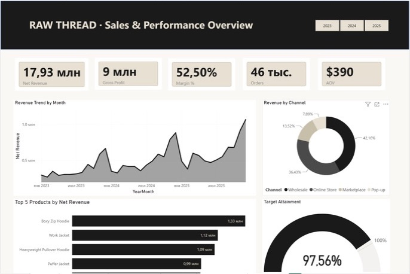
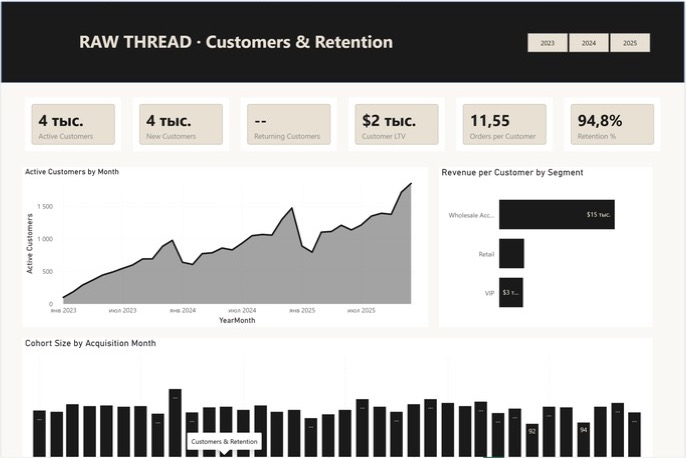
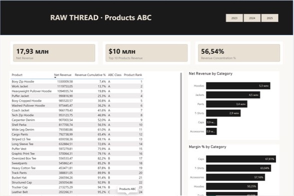
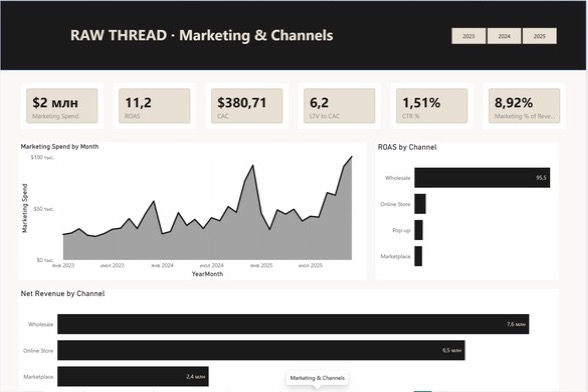
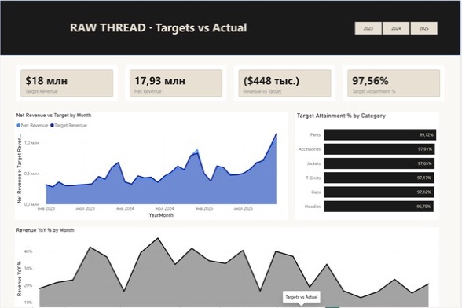

# RAW THREAD — Power BI report (Case 4)

Advanced Power BI report on a synthetic star schema for a fictional premium
streetwear brand. Demo project, no real customers.

**3 years · 78,249 sales lines · 46,000 orders · $17.9M net revenue**

## Report pages

| # | Page | What it shows |
|---|---|---|
| 1 | Overview | Net revenue, gross profit, margin, orders, AOV; trend, channel mix, top products, target attainment |
| 2 | Products & Inventory | Units sold / on hand, inventory value, turnover, days of inventory |
| 3 | Customers & Retention | Active / new / returning customers, LTV, orders per customer, retention, cohort sizes |
| 4 | Products ABC | Pareto ranking, cumulative share, ABC class, revenue concentration |
| 5 | Marketing & Channels | Spend, ROAS, CAC, LTV:CAC, CTR, marketing share of revenue |
| 6 | Targets vs Actual | Budget vs actual by month and category, attainment, YoY |

A year slicer is synced across pages (all years selected by default).







## Model

Nine tables, one-to-many single-direction relationships (dimension -> fact),
`DimDate` marked as the date table, 44 measures in a `_Measures` table.
Highlights: time intelligence (LY, YoY, YTD, MAT), plan-vs-actual with
`TREATAS` against an unrelated `FactTargets`, semi-additive inventory, an
inactive `DimCustomer[AcquisitionDate] -> DimDate[Date]` relationship used with
`USERELATIONSHIP` for new customers, ABC / Pareto ranking.
See [DATA_MODEL.md](DATA_MODEL.md) and [DAX_LIBRARY.md](DAX_LIBRARY.md).

Control values with all years selected: net revenue **$17,934,785**,
46k orders, target attainment **97.56%**.

## Files

```
pbip/                           Power BI Project (PBIP / PBIR + TMDL, git-friendly)
  RAW_THREAD.pbip               open this in Power BI Desktop
  RAW_THREAD.Report/            pages and visuals as JSON
  RAW_THREAD.SemanticModel/     tables, measures, relationships as TMDL
RAW_THREAD_warehouse.zip        the nine source CSVs
preview/                        page screenshots
```

## Open it

Power BI Desktop (Windows) -> File -> Open -> `pbip/RAW_THREAD.pbip`.
If `.pbip` is not offered, enable *Power BI Project (.pbip) save option* in
Options -> Preview features. Data is imported from the CSVs in the zip: unzip them
and repoint each query (Transform data -> Source; the paths are currently
`C:\Users\admin\Downloads\New\*.csv`), then Refresh.

## Status

Not included yet: a compiled `.pbix`, the "Publish to web" link, and the two
hidden helper pages (tooltip / drillthrough). Pages 3-6 were added by editing
the PBIR files and checked in Desktop on the full dataset; the last small
measure change (`Returning Customers` returns 0 instead of blank) was made
after that check and has not been re-rendered.
